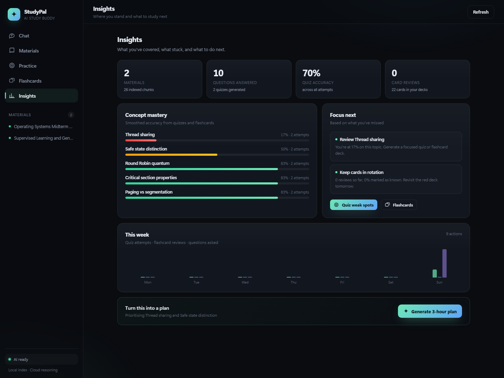
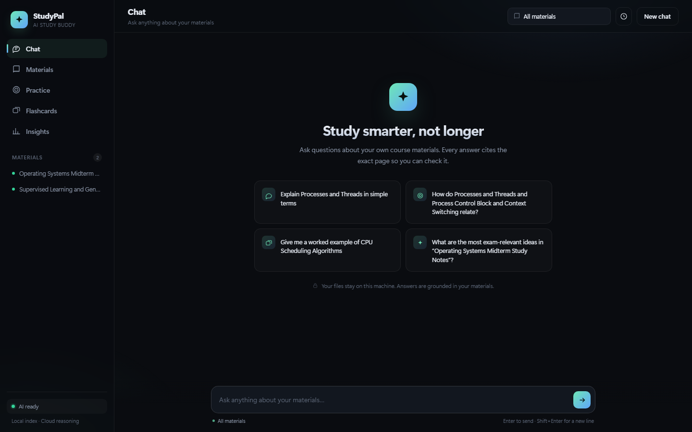
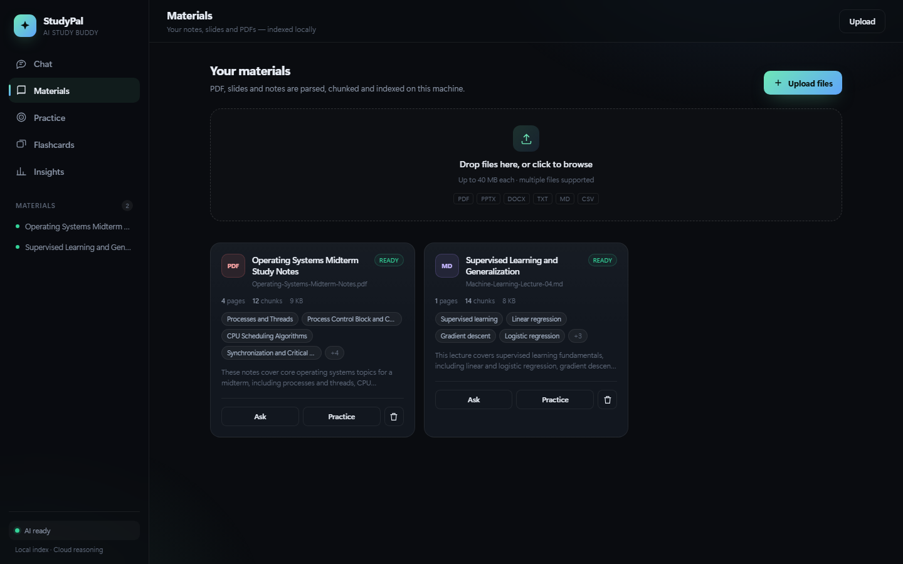
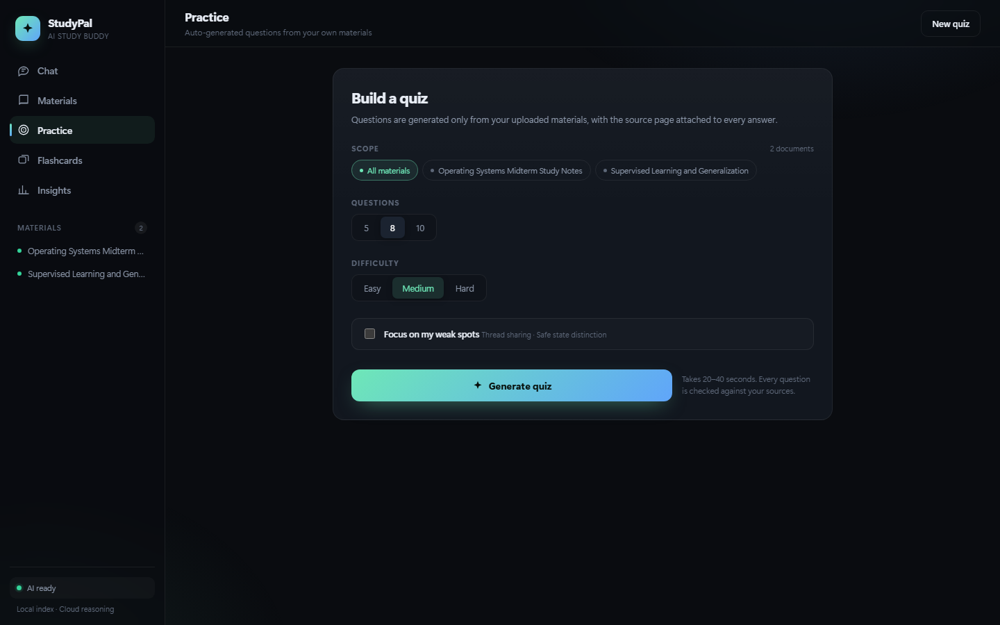

# StudyPal — AI Study Buddy

**Turn your course materials into an AI tutor that cites every answer.**

> Troy Hackathon 2026 · Track 2 · Language Models · **AI Study Pal / Buddy**
> One web app for the whole loop: upload → ask (with citations) → practice → review → know what to study next.

[中文版 (Chinese)](README.zh.md)



---

## What it solves

Most study tools just drop a PDF into a chatbot. StudyPal solves three sharper problems:

1. **Answers you can't trust** → every claim carries an `[n]` citation you can click back to the source page.
2. **You forget after learning** → auto-generated quizzes and flashcards feed a per-concept mastery map.
3. **You don't know what to study next** → a weak-spot profile plus an AI-generated 3-hour study plan.

The one-liner for your pitch:

> It doesn't just read for you — it makes sure you actually learned it, and every answer is checkable.

---

## Features

| Module | What it does |
|---|---|
| **Materials** | Drag & drop PDF / PPTX / DOCX / TXT / MD / CSV; parsed, chunked and indexed locally; auto title, summary and topic tags; page / chunk / status shown |
| **Chat** | Streaming Q&A grounded in your materials; `[n]` citation markers; source drawer with document, page and excerpt; says "not found" honestly when the answer isn't in your files; sessions resume |
| **Practice** | 3–20 multiple-choice questions; Easy / Medium / Hard; instant feedback + explanation + source page; server-side scoring updates mastery; can target weak concepts only |
| **Flashcards** | 4–30 cards; 3D flip; "Again / Got it" self-rating; `Space` / `←` / `→` keys; reviews persist |
| **Insights** | Concept mastery bars; weak-spot list; 7-day activity; personalized suggestions; one-click 3-hour study plan |
| **Privacy** | Files and index stay on your machine; only retrieved snippets go to the cloud model; no account, no tracking |

### Screenshots

| Chat | Materials |
|---|---|
|  |  |

| Practice | Insights |
|---|---|
|  |  |

---

## Quick start

### 1. Prerequisites

- **Python 3.11+**
- **A DeepSeek API key** ([platform.deepseek.com](https://platform.deepseek.com))
- Optional: [Ollama](https://ollama.com) for local embeddings (without it, StudyPal falls back to keyword search — still fully usable)

### 2. Launch

**Windows** — double-click `start.bat` (installs dependencies, starts the server, opens your browser).

**macOS / Linux** — run `bash start.sh`.

Or manually:

```bash
python -m pip install -r requirements.txt
python run.py
```

### 3. Enter your API key

Your browser opens **http://127.0.0.1:8000** and a popup asks for your DeepSeek key on first launch. Paste it once and you're done — it's stored only on this machine (`data/studypal.db`, gitignored). No `.env` editing required. You can change the key, base URL or model anytime in **Settings**.

The backend defaults to DeepSeek (`deepseek-flash`, `https://api.deepseek.com/v1`).

### 4. Add some material

`sample_data/` ships two course notes. Drop them into **Materials** and start asking.

---

## Architecture

```
Browser (vanilla HTML/CSS/JS — no build, no CDN)
   │ fetch JSON + SSE
FastAPI (Python 3.13, single process)
   ├── SQLite (WAL)  documents / chunks / FTS5 / quizzes / cards / mastery / settings
   ├── Retrieval: Ollama nomic-embed-text (768d) + BM25 → RRF fusion
   └── Generation: DeepSeek Cloud API (deepseek-flash)
```

| Layer | Choice | Why |
|---|---|---|
| Frontend | Vanilla JS SPA | No Node on the demo machine; zero build, zero CDN |
| Backend | FastAPI + Uvicorn | Async streaming, typed validation, single-file start |
| Storage | SQLite + FTS5 | Single file, zero ops, CJK bigram search for Chinese |
| Vector search | Ollama + numpy cosine | A few thousand chunks need no vector DB; DeepSeek has no embedding API |
| Generation | DeepSeek `deepseek-flash` | Cloud inference, 1M context, no local GPU |
| Streaming | SSE | Low time-to-first-token, good demo feel |

Deeper API / schema / data-flow docs: **[BACKEND.md](BACKEND.md)** · product & UI spec: **[DESIGN.md](DESIGN.md)**.

---

## 3-minute demo script

1. **0:00 · Materials** — drop in `sample_data/Operating-Systems-Midterm-Notes.pdf`; parsing, chunking and local indexing finish in ~30s with auto topic tags.
2. **0:30 · Chat** — ask *"What are the four necessary conditions for deadlock?"* → streamed answer → click `[1]` to open page 3.
3. **1:00 · Chat** — ask something not in the notes → it says it can't find it and suggests uploading more.
4. **1:20 · Practice** — generate 5 Medium questions → answer two wrong on purpose → result page shows the weak concepts.
5. **2:10 · Flashcards** — generate 8 cards → `Space` to flip, `→` to mark known.
6. **2:40 · Insights** — mastery bars updated → click **Generate 3-hour plan** to close.

---

## Project structure

```
studypal/
├── app/                  FastAPI backend
│   ├── main.py           routes, upload, SSE, analytics
│   ├── rag.py            hybrid retrieval & context
│   ├── ingest.py         PDF/DOCX/PPTX parsing & chunking
│   ├── llm.py            DeepSeek client
│   ├── prompts.py        prompt templates
│   ├── db.py             SQLite schema
│   ├── settings.py       runtime LLM settings (key/base_url/model)
│   └── config.py         env config
├── static/               frontend (no build)
│   ├── index.html
│   ├── styles.css
│   └── app.js
├── sample_data/          demo materials
├── docs/                 README screenshots
├── data/                 runtime files (gitignored)
├── run.py                start entry (opens browser)
├── start.bat / start.sh  one-click install + launch
├── README.md / README.zh.md
├── BACKEND.md            backend & API docs
├── DESIGN.md             feature list & UI spec
└── requirements.txt
```

---

## API at a glance

Full request/response, SSE events and error codes: **[BACKEND.md](BACKEND.md)**.

| Method | Path | Purpose |
|---|---|---|
| GET | `/api/settings` | Current LLM config (key masked) |
| PUT | `/api/settings` | Save API key / base URL / model |
| POST | `/api/documents` | Upload & index asynchronously |
| GET | `/api/documents` | List documents & status |
| POST | `/api/chat` | SSE streaming Q&A with citations |
| POST | `/api/quiz/generate` | Generate a quiz |
| POST | `/api/quiz/{id}/submit` | Submit & score |
| POST | `/api/flashcards/generate` | Generate flashcards |
| POST | `/api/flashcards/review` | Record a review |
| GET | `/api/analytics` | Mastery & suggestions |
| POST | `/api/study-plan` | Generate a study plan |

---

## Scoring alignment

| Criterion | Weight | Implementation |
|---|---|---|
| Innovation & Creativity | 20% | Verifiable cited Q&A + mastery loop + local-first architecture |
| Technical Excellence | 20% | Hybrid retrieval (dense + BM25 + RRF), SSE, JSON repair-retry, background indexing |
| Functionality & Completeness | 20% | Upload, Q&A, quiz, scoring, flashcards, analytics, study plan — all working |
| Impact & Usefulness | 15% | Solves "unverifiable AI answers" and "don't know what to revise" |
| Teamwork & Collaboration | 15% | Modular backend + standalone frontend + docs, easy to parallelize |
| Presentation & Pitch | 10% | 3-minute script + screenshots + live demo |

---

## Design notes & limits

- **Answers only from your materials**: no external knowledge; it says "not found" instead of hallucinating.
- **Local index, cloud generation**: files and vectors stay on the machine; only retrieved snippets reach the model.
- **Scanned PDFs without a text layer**: no auto-OCR yet; marked as failed clearly.
- **Chinese materials**: FTS uses CJK bigrams so they stay searchable; `nomic-embed-text` is English-centric — for Chinese, swap in `bge-m3` and update `EMBED_DIM`.
- **Single-user, no auth**: built for local demo — don't expose it to the public internet.
- **Mastery**: smoothed accuracy; no SM-2 spaced repetition yet.

### Roadmap

- OCR for scanned & handwritten notes
- Mistake re-drill and SM-2 review queue
- Multi-user, course spaces, LMS (Canvas) integration
- Export a review pack (Q&A + mistakes + cards)
- Chinese embeddings & full localization

---

## Note

Entry for Troy Hackathon 2026. `.env` and `data/` are gitignored, so no API key or local index is ever committed.
