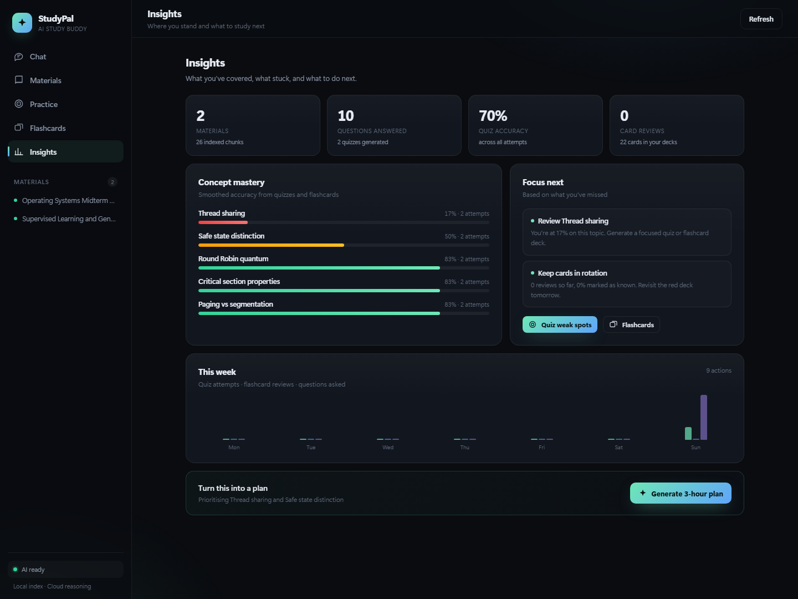
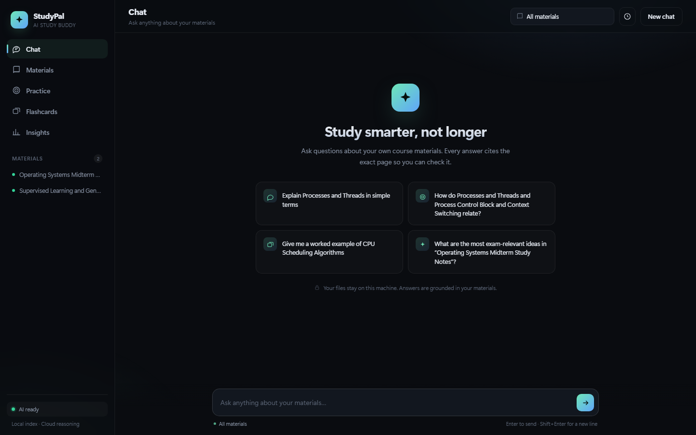
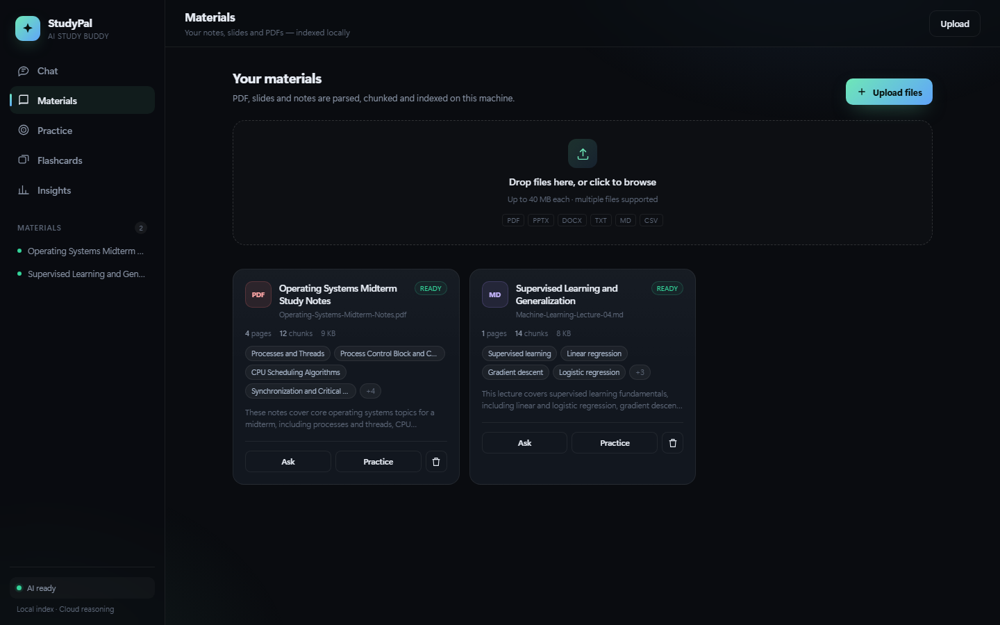
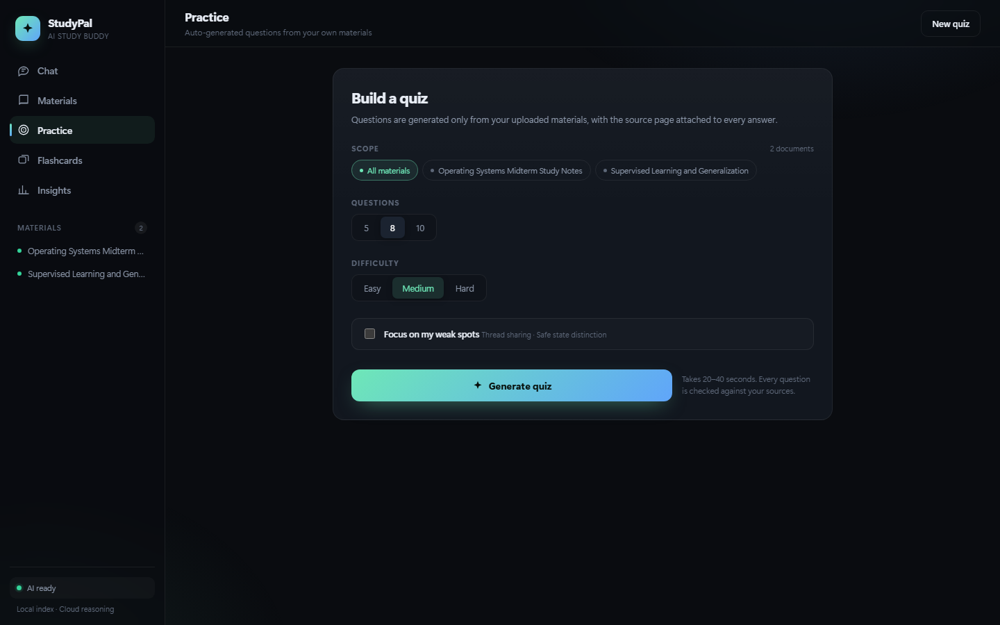

# StudyPal — 把课件变成会引用原文的私人助教

> Troy Hackathon 2026 · 方向 2 · Language Models · **AI Study Pal / Buddy**
> 一个网页完成闭环：上传 → 提问（带引用）→ 练习 → 复习 → 知道下一步学什么。

[English version](README.md)



---

## 这是什么

大多数学习助手只是把 PDF 丢进聊天框。StudyPal 解决的是三个更具体的问题：

1. **答案不可信** → 每句结论都带 `[n]` 引用，可点回原文页码。
2. **学过就忘** → 自动出题、闪卡自评，结果写入概念掌握度。
3. **不知道下一步学什么** → 薄弱点画像 + AI 生成的三小时学习计划。

演示时的一句话：

> 它不是帮你读，而是确保你真的学会了 —— 而且每一句答案你都能查证。

---

## 功能

| 模块 | 能力 |
|---|---|
| **Materials** | 拖拽上传 PDF / PPTX / DOCX / TXT / MD / CSV；后台解析、切块、本地索引；自动提取标题、摘要与主题标签；显示页数、块数、处理状态 |
| **Chat** | 基于材料流式问答；`[n]` 引用角标；来源抽屉显示文档名、页码、原文；材料里没有答案时明确说「找不到」；会话历史可恢复 |
| **Practice** | 3–20 道单选题；Easy / Medium / Hard；作答即时反馈 + 解析 + 来源页码；交卷后服务端判分并更新掌握度；可只考薄弱概念 |
| **Flashcards** | 4–30 张闪卡；3D 翻转；「没记住 / 记住了」自评；键盘 `Space` / `←` / `→`；复习记录持久化 |
| **Insights** | 概念掌握度条；薄弱点列表；近 7 天活动；个性化建议；一键生成 3 小时学习计划 |
| **Settings** | 网页内配置 API 密钥 / 接口地址 / 模型；中英文界面切换 |
| **Privacy** | 文件与索引都留在本机；只有检索到的片段会发给云端模型；无账号、无追踪 |

### 界面

| Chat | Materials |
|---|---|
|  |  |

| Practice | Insights |
|---|---|
|  |  |

---

## 快速开始（三步）

### 1. 环境

- **Python 3.11+**
- **一个 DeepSeek API Key**（[platform.deepseek.com](https://platform.deepseek.com)）
- 可选：Ollama（本地向量化；不装也能用纯关键词检索）

### 2. 启动

**Windows** —— 双击 `start.bat`（自动安装依赖、启动服务、打开浏览器）。

**macOS / Linux** —— 运行 `bash start.sh`。

或手动：

```bash
python -m pip install -r requirements.txt
python run.py
```

### 3. 输入 API Key

浏览器自动打开 **http://127.0.0.1:8000**，首次启动会弹窗提示输入 DeepSeek 密钥，粘贴一次即可 —— 密钥只保存在本机（`data/studypal.db`，已 gitignore），**无需手动编辑 `.env`**。之后可随时在 **Settings** 里修改密钥、接口地址或模型。

后端默认使用 DeepSeek（`deepseek-flash`、`https://api.deepseek.com/v1`）。

### 4. 准备演示材料

`sample_data/` 已包含两份课程材料，在 Materials 页拖入即可。

---

## 技术架构

```
浏览器 (原生 HTML/CSS/JS，无构建、无 CDN)
   │ fetch JSON + SSE
FastAPI (Python 3.13，单进程)
   ├── SQLite (WAL)  documents / chunks / FTS5 / quizzes / cards / mastery / settings
   ├── 检索：Ollama nomic-embed-text (768d) + BM25 → RRF 融合
   └── 生成：DeepSeek Cloud API (deepseek-flash)
```

| 层 | 选型 | 理由 |
|---|---|---|
| 前端 | 原生 JS 单页应用 | 演示机器无 Node，零构建、零 CDN 依赖 |
| 后端 | FastAPI + Uvicorn | 异步流式、类型校验、单文件启动 |
| 存储 | SQLite + FTS5 | 单文件、零运维、支持中文 bigram 检索 |
| 向量检索 | Ollama + numpy 余弦 | 几千 chunk 无需向量数据库；DeepSeek 无 embedding API |
| 生成 | DeepSeek `deepseek-flash` | 云端推理、1M 上下文、无需本地 GPU |
| 流式 | SSE | 首字延迟低，演示观感好 |

更细的接口、库表、数据流见 **[BACKEND.md](BACKEND.md)**；产品与前端设计见 **[DESIGN.md](DESIGN.md)**。

---

## 三分钟演示脚本

1. **0:00 · Materials** 拖入 `sample_data/Operating-Systems-Midterm-Notes.pdf`，展示 30 秒内完成解析、分块、本地索引，主题标签自动生成。
2. **0:30 · Chat** 提问：「What are the four necessary conditions for deadlock?」→ 流式回答 → 点击 `[1]` 打开原文第 3 页。
3. **1:00 · Chat** 问一个材料里没有的问题 → 它明确说找不到，并建议上传相关文档。
4. **1:20 · Practice** 选择 5 题 / Medium → 生成 → 故意答错两题 → 结果页显示薄弱概念。
5. **2:10 · Flashcards** 生成 8 张卡 → 用 `Space` 翻面、`→` 标记记住。
6. **2:40 · Insights** 掌握度条更新 → 点击 **Generate 3-hour plan**，收尾。

---

## 项目结构

```
studypal/
├── app/                  FastAPI 后端
│   ├── main.py           路由、上传、SSE、统计
│   ├── rag.py            混合检索与上下文
│   ├── ingest.py         PDF/DOCX/PPTX 解析与切块
│   ├── llm.py            DeepSeek 客户端
│   ├── prompts.py        提示词
│   ├── db.py             SQLite schema
│   ├── settings.py       运行时 LLM 配置（key/base_url/model）
│   └── config.py         环境配置
├── static/               前端（无构建）
│   ├── index.html
│   ├── styles.css
│   └── app.js
├── sample_data/          演示材料
├── docs/                 README 截图
├── data/                 运行时生成（已 gitignore）
├── run.py                启动入口（自动开浏览器）
├── start.bat / start.sh  一键安装 + 启动
├── README.md / README.zh.md
├── BACKEND.md            后端接口与架构文档
├── DESIGN.md             功能清单与 UI 设计稿
└── requirements.txt
```

---

## API 速览

完整请求/响应、SSE 事件、错误码见 [BACKEND.md](BACKEND.md)。

| Method | Path | 用途 |
|---|---|---|
| GET | `/api/settings` | 当前 LLM 配置（密钥已打码） |
| PUT | `/api/settings` | 保存密钥 / 接口地址 / 模型 |
| POST | `/api/documents` | 上传并异步索引 |
| GET | `/api/documents` | 文档列表与状态 |
| POST | `/api/chat` | SSE 流式问答（带引用） |
| POST | `/api/quiz/generate` | 生成测验 |
| POST | `/api/quiz/{id}/submit` | 交卷判分 |
| POST | `/api/flashcards/generate` | 生成闪卡 |
| POST | `/api/flashcards/review` | 记录复习 |
| GET | `/api/analytics` | 掌握度与建议 |
| POST | `/api/study-plan` | 生成学习计划 |

---

## 与评分标准的对应

| 评分项 | 权重 | 对应实现 |
|---|---|---|
| Innovation & Creativity | 20% | 引用可验证的问答 + 掌握度闭环 + 本地优先架构 |
| Technical Excellence | 20% | 混合检索（Dense + BM25 + RRF）、SSE、JSON 修复重试、后台索引 |
| Functionality & Completeness | 20% | 上传、问答、出题、判分、闪卡、画像、学习计划全部可用 |
| Impact & Usefulness | 15% | 解决「AI 答案不可信」与「不知道复习什么」两个真实问题 |
| Teamwork & Collaboration | 15% | 模块化后端 + 独立前端 + 文档，便于并行开发 |
| Presentation & Pitch | 10% | 三分钟演示脚本 + 完整截图 + 可现场操作 |

---

## 设计取舍与边界

- **只对上传材料作答**：不接外部知识；找不到就明确说找不到，避免幻觉。
- **本地索引、云端生成**：文件与向量留在本机，只有检索片段发给模型。
- **扫描版 PDF 无文字层**：当前不自动 OCR，会明确标记失败。
- **中文材料**：FTS 使用 CJK bigram 保证可检索；`nomic-embed-text` 以英文为主，中文场景建议换 `bge-m3` 并同步 `EMBED_DIM`。
- **单用户、无鉴权**：面向本机演示，请勿直接暴露公网。
- **掌握度**：平滑正确率，尚未实现 SM-2 间隔重复。

### Roadmap

- OCR 扫描件与手写笔记
- 错题重练与 SM-2 复习队列
- 多用户、课程空间、LMS（Canvas）集成
- 导出复习包（问答 + 错题 + 闪卡）
- 中文 embedding 与多语言界面

---

## 说明

本项目为 Troy Hackathon 2026 参赛作品，代码与文档用于演示与评审。
`.env`、`data/` 已加入 `.gitignore`，不会提交密钥或本地索引。
